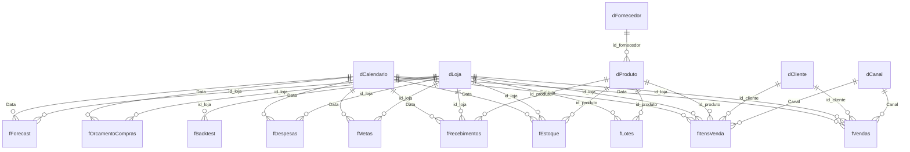

# Relacionamentos

Todos 1:N, direção única (dimensão → fato), ativos. Nenhuma relação fato–fato, nenhuma bidirecional, nenhuma N:N.

| Fato (N) | Coluna | Dimensão (1) | Coluna |
|---|---|---|---|
| fVendas | data_venda | dCalendario | Data |
| fItensVenda | data_venda | dCalendario | Data |
| fEstoque | data_mes | dCalendario | Data |
| fMetas | data_mes | dCalendario | Data |
| fDespesas | data_mes | dCalendario | Data |
| fRecebimentos | data_recebimento | dCalendario | Data |
| fOrcamentoCompras | data_mes | dCalendario | Data |
| fForecast | data_mes | dCalendario | Data |
| fVendas | id_loja | dLoja | id_loja |
| fItensVenda | id_loja | dLoja | id_loja |
| fEstoque | id_loja | dLoja | id_loja |
| fMetas | id_loja | dLoja | id_loja |
| fDespesas | id_loja | dLoja | id_loja |
| fRecebimentos | id_loja | dLoja | id_loja |
| fOrcamentoCompras | id_loja | dLoja | id_loja |
| fLotes | id_loja | dLoja | id_loja |
| fForecast | id_loja | dLoja | id_loja |
| fBacktest | id_loja | dLoja | id_loja |
| fItensVenda | id_produto | dProduto | id_produto |
| fEstoque | id_produto | dProduto | id_produto |
| fRecebimentos | id_produto | dProduto | id_produto |
| fLotes | id_produto | dProduto | id_produto |
| dProduto | id_fornecedor | dFornecedor | id_fornecedor |
| fVendas | id_cliente | dCliente | id_cliente |
| fItensVenda | id_cliente | dCliente | id_cliente |
| fVendas | canal | dCanal | Canal |
| fItensVenda | canal | dCanal | Canal |

Desconectadas: `dCenario` (what-if), `dDRE` (linhas da DRE), `_Medidas`.
`fLotes` não se liga ao calendário (fotografia de 30/09/2026). `dFornecedor` filtra fatos via `dProduto` (fornecedor único por SKU, validado).

