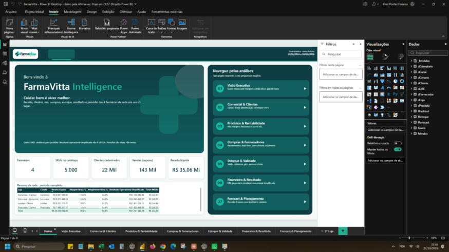
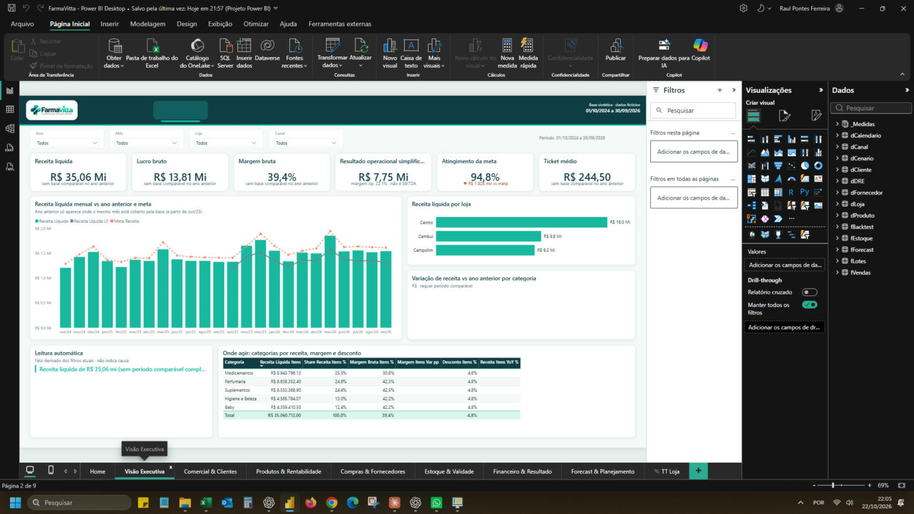
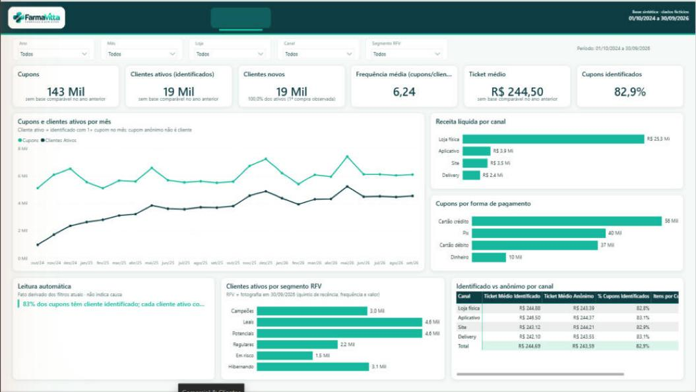
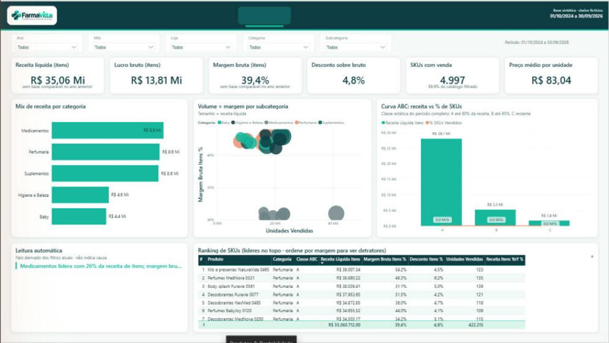
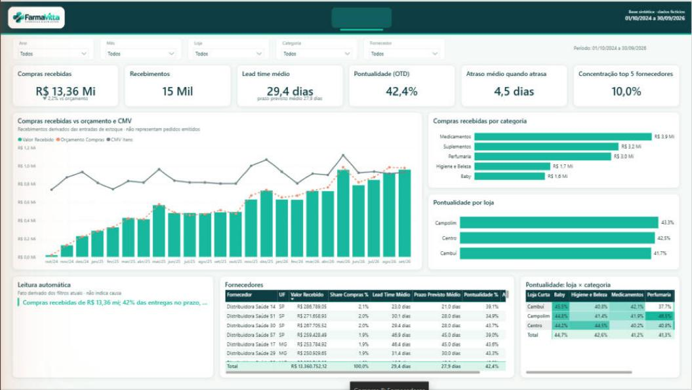
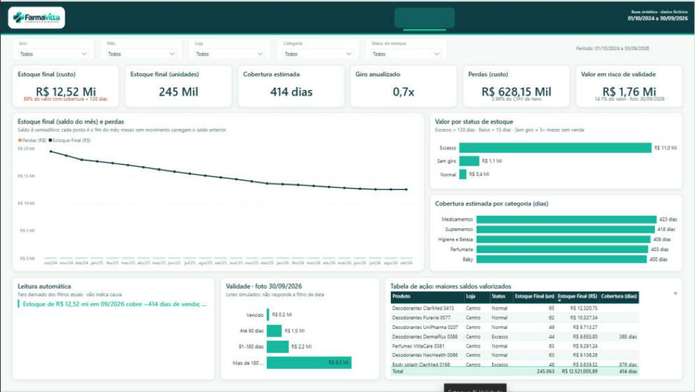
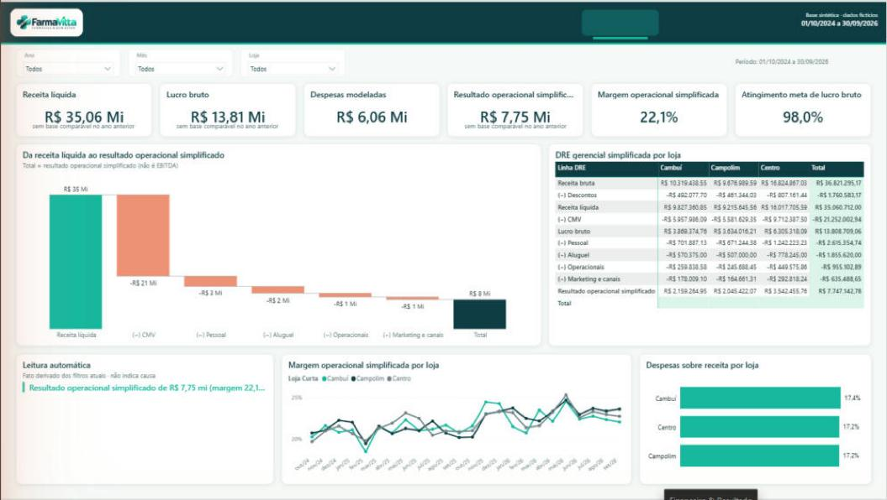
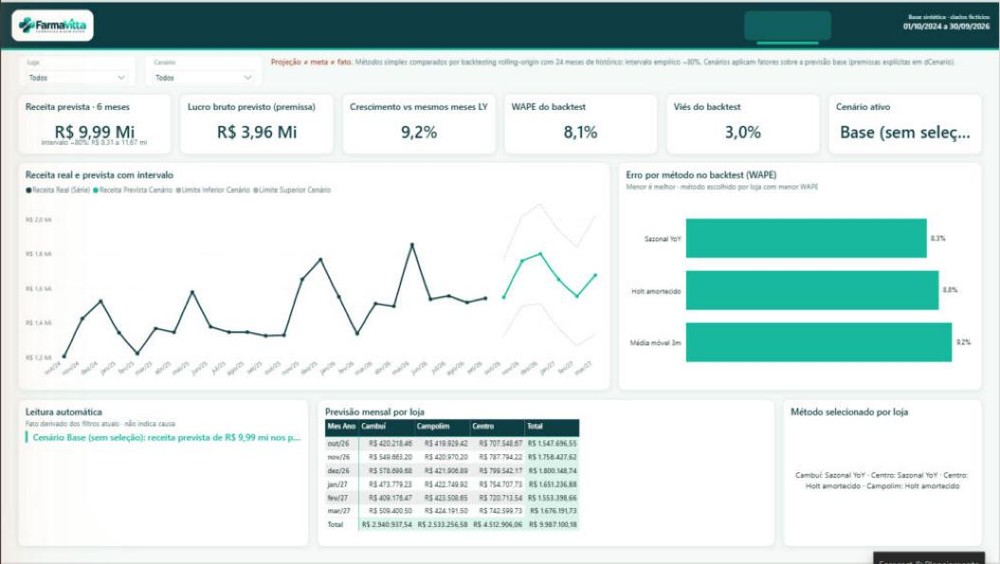

# v1 · Clássico

Versão fiel ao manual de identidade FarmaVitta: canvas branco gelo, cabeçalho petróleo e visuais nativos do Power BI. Não usa visuais externos.

**Abrir:** `FarmaVitta.pbip` → ajustar o parâmetro `PastaProjeto` para a raiz do repositório → Atualizar.

## Páginas

Home · Visão Executiva · Comercial & Clientes · Produtos & Rentabilidade · Compras & Fornecedores · Estoque & Validade · Financeiro & Resultado · Forecast & Planejamento · tooltip de receita.

## Destaques

- 183 medidas em pastas (`00 Base` a `99 Auditoria`), incluindo narrativas automáticas e textos/cores de variação.
- Comparações com o ano anterior só aparecem quando o período está coberto pela base, limitadas à data base de 30/09/2026.
- Botão "Limpar filtros" em todas as páginas analíticas.

## Prints

Os prints em [`prints/`](prints) foram capturados no Power BI Desktop com a **v1.0**. Eles ainda mostram três problemas corrigidos na v1.1 (ver [CHANGELOG](../00_Governanca/CHANGELOG.md)):

- botões de navegação sem texto;
- Jundiaí e Piracicaba agrupadas como "Centro";
- narrativa cortada em uma linha.

| Home | Visão Executiva |
|---|---|
|  |  |
| **Comercial & Clientes** | **Produtos & Rentabilidade** |
|  |  |
| **Compras & Fornecedores** | **Estoque & Validade** |
|  |  |
| **Financeiro & Resultado** | **Forecast & Planejamento** |
|  |  |

Validação completa: [VALIDACAO_v1.md](VALIDACAO_v1.md).
