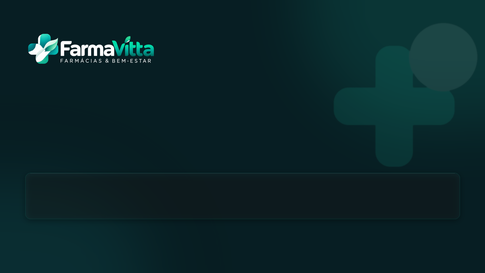
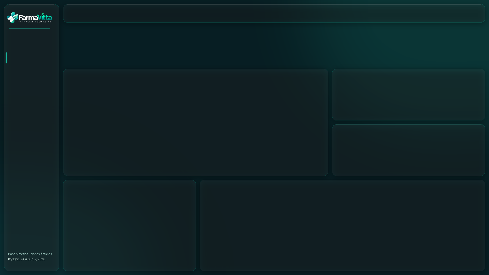

# v2 · Moderno (HTML Content + Deneb)

Versão construída com o método *Power BI moderno: HTML Content + Deneb + PBIP*: tema escuro com as cores da marca, menu lateral em vidro, cards HTML com sparkline SVG, gráficos Deneb/Vega-Lite e painel de filtros oculto por bookmarks.

**Abrir:** `FarmaVitta_v2.pbip` com internet → ajustar o parâmetro `PastaProjeto` para a raiz do repositório → Atualizar.

> ⚠️ **Status:** gerada e validada fora do Desktop (esquemas JSON, TMDL, DAX das medidas novas no modelo com dados), mas **ainda não aberta no Power BI Desktop**. Ainda não há prints. Ver [VALIDACAO_v2.md](VALIDACAO_v2.md).

## O que tem

| Recurso | Implementação |
|---|---|
| Home | Logo negativo, slogan, cards HTML e botão **Iniciar** |
| Navegação | Menu lateral com 8 botões nativos sobre fundo em vidro (página ativa destacada) |
| KPIs | 1 visual HTML Content por página: 6 cards com valor, comparação, cor semântica (verde/âmbar/coral) e sparkline de 12 meses animada em CSS |
| Gráficos Deneb | `Deneb/*.vl.json`: receita mensal com destaque do maior mês, mapa de calor dia × mês, Pareto por subcategoria, mapa de calor de pontualidade, dot plot de cobertura, waterfall da DRE, previsão com faixa |
| Filtros | Painel oculto (bookmarks abrir/fechar por página), Aplicar e fechar, Limpar, chips HTML com filtros ativos |
| Tabelas | Barras SVG por linha (`dataCategory: ImageUrl`) |
| Tooltip | Página dedicada em HTML |

## Prévia dos fundos

| Home | Páginas analíticas |
|---|---|
|  |  |

## Decisões a homologar

- O manual pede canvas claro; esta versão é escura por escolha de estilo. A v1 é a versão fiel ao manual.
- O âmbar `#F2C46D` foi adicionado para o estado de "atenção".
- O logo negativo foi derivado do PNG: é provisório até existir a versão oficial clara.
